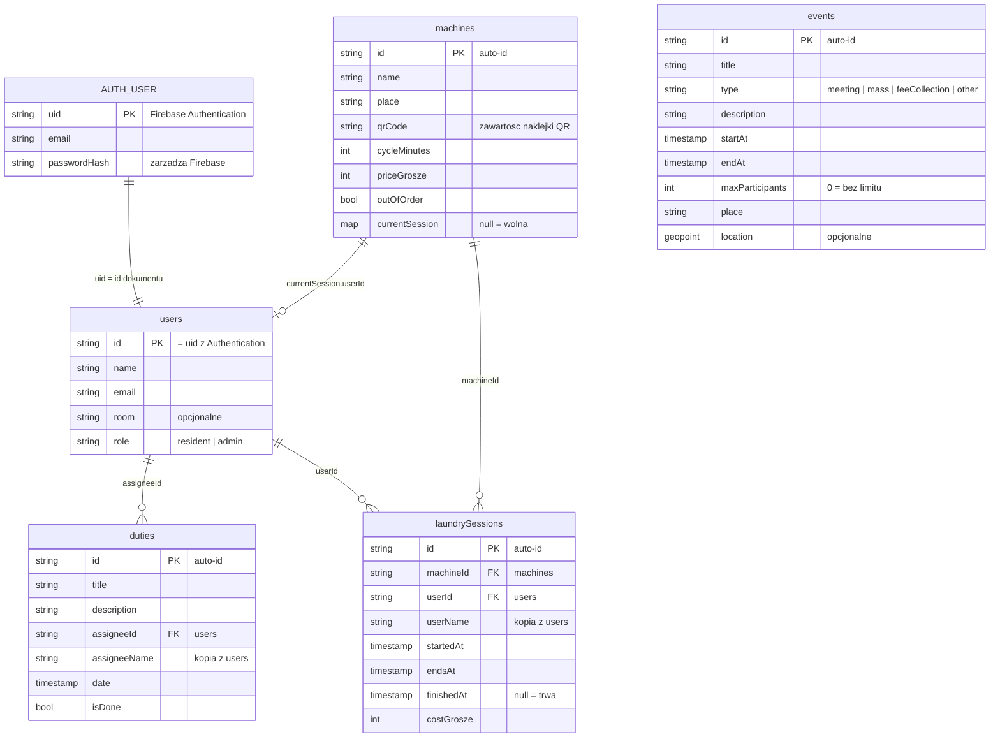

# Struktura bazy danych (Cloud Firestore)

## Diagram

> Strzałki oznaczają **odwołania przez ID** (w Firestore nie ma kluczy obcych ani JOIN-ów – aplikacja sama doczytuje powiązane dokumenty).

## Kolekcje

### `users/{uid}`
Profil użytkownika. **ID dokumentu = UID z Firebase Authentication** (dzięki temu reguły bezpieczeństwa mogą sprawdzić rolę zalogowanej osoby).

| Pole | Typ | Wymagane | Opis |
|---|---|---|---|
| `name` | string | tak | imię i nazwisko |
| `email` | string | tak | e-mail (kopia z Authentication) |
| `room` | string | nie | numer pokoju |
| `role` | string | tak | `resident` albo `admin` |

Użytkownik nie może sam zmienić swojego pola `role` (reguły).

### `events/{eventId}`
Wydarzenia w kalendarium.

| Pole | Typ | Wymagane | Opis |
|---|---|---|---|
| `title` | string | tak | tytuł |
| `type` | string | tak | `meeting` (spotkanie organizacyjne), `mass` (msza), `feeCollection` (zbiórka opłat), `other` |
| `description` | string | nie | opis |
| `startAt` | timestamp | tak | początek |
| `endAt` | timestamp | tak | koniec |
| `maxParticipants` | int64 | tak | limit osób; **`0` = bez limitu** |
| `place` | string | tak | nazwa miejsca, np. „Świetlica” |
| `location` | geopoint | nie | współrzędne (np. do mapy) |

### `duties/{dutyId}`
Dyżury przydzielone mieszkańcom.

| Pole | Typ | Wymagane | Opis |
|---|---|---|---|
| `title` | string | tak | nazwa obowiązku |
| `description` | string | nie | szczegóły |
| `assigneeId` | string | tak | UID osoby z `users` |
| `assigneeName` | string | tak | imię osoby (kopia, żeby lista nie doczytywała profili) |
| `date` | timestamp | tak | dzień dyżuru |
| `isDone` | boolean | tak | czy wykonany |

### `machines/{machineId}`
Pralki wraz z **aktualnym stanem** (wolna/zajęta).

| Pole | Typ | Wymagane | Opis |
|---|---|---|---|
| `name` | string | tak | np. „Pralka 1” |
| `place` | string | tak | gdzie stoi |
| `qrCode` | string | tak | tekst zakodowany w naklejce QR (unikalny) |
| `cycleMinutes` | int64 | tak | długość cyklu prania |
| `priceGrosze` | int64 | tak | cena za pranie w groszach (500 = 5,00 zł) |
| `outOfOrder` | boolean | tak | awaria |
| `currentSession` | map / null | tak | `null` = wolna; w trakcie prania: `{ sessionId, userId, userName, startedAt, endsAt }` |

### `laundrySessions/{sessionId}`
Historia prań – podstawa do naliczania opłat. Tworzona przez aplikację przy starcie prania (nie dodawać ręcznie).

| Pole | Typ | Wymagane | Opis |
|---|---|---|---|
| `machineId` | string | tak | ID z `machines` |
| `userId` | string | tak | UID z `users` |
| `userName` | string | tak | kopia imienia |
| `startedAt` | timestamp | tak | start prania |
| `endsAt` | timestamp | tak | planowany koniec |
| `finishedAt` | timestamp / null | tak | faktyczny koniec; `null` = trwa |
| `costGrosze` | int64 | tak | naliczona opłata |
